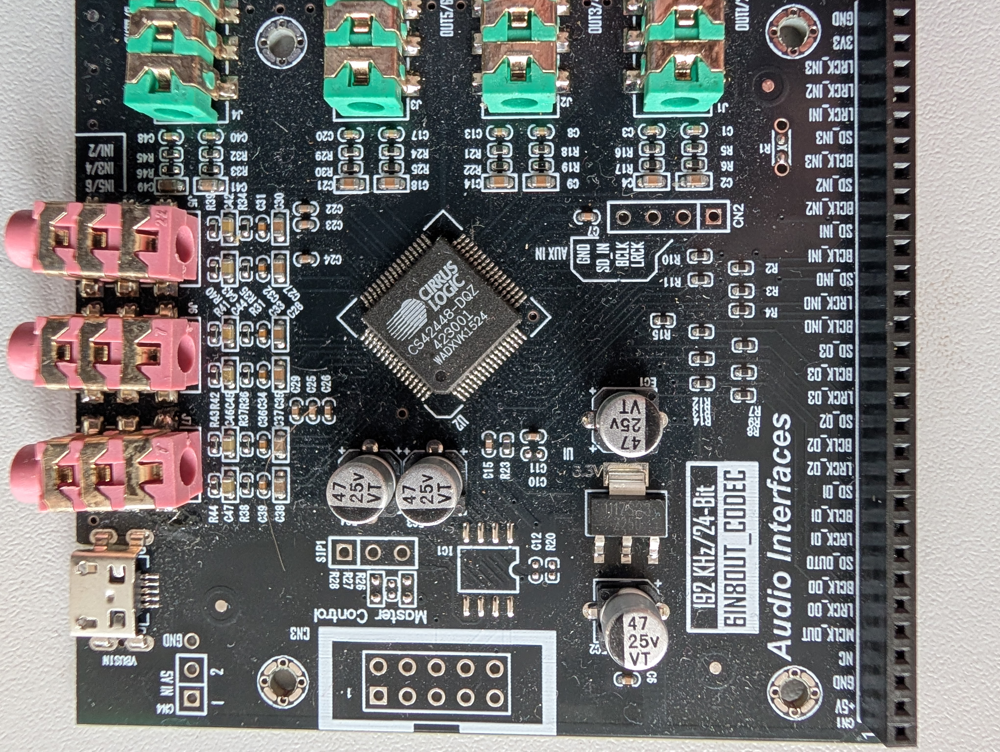

# ODROID N2: a CS42448 codec over TDM (plan)

Status: plan, nothing built yet (2026-11-28). Goal: 8 analog outputs and 6 analog inputs on the
ODROID N2 (S922X, Amlogic G12B) through a Cirrus Logic CS42448 on TDM-B, for zynthian and
MicroDexed-touch. Starting point: the brainstorming notes in zynthian-stuff
(`odroid-n2/audio-hw-cd42448.md`); their device tree is written for Hardkernel's vendor kernel
(4.9) and doesn't apply to ours. This document is the mainline version.

Our N2 runs `linux-postmarketos-amlogic-rt` 7.2.14 (aports/kernel; PREEMPT_RT, 1000 Hz, the ALSA
sequencer since r1), the dtb `amlogic/meson-g12b-odroid-n2` (devices/device-odroid-n2), booted by
U-Boot through postmarketOS' generated `/boot/extlinux/extlinux.conf`.

## What is checked (on the running N2, 2026-11-28)

- Pin groups (pinctrl debugfs, `ff634400.bus:pinctrl@40`), all currently unclaimed:
  `mclk0_a` GPIOA_0, `tdm_b_sclk` GPIOA_1, `tdm_b_fs` GPIOA_2, `tdm_b_dout0` and `tdm_b_din0`
  both GPIOA_3, `tdm_b_din1` GPIOA_4, `i2c2_sda_x` GPIOX_17, `i2c2_sck_x` GPIOX_18.
  So full duplex needs two lanes: playback on lane 0 (GPIOA_3), capture on lane 1 (GPIOA_4).
- The TDM drivers are there as modules: `SND_MESON_AXG_TDM_INTERFACE`, `_TDMIN`, `_TDMOUT`,
  `_SOUND_CARD`, `SND_MESON_G12A_TOHDMITX`; `SND_SOC_SPDIF` (spdif-dit / -dir, usable as stand-in
  codecs).
- The codec driver is NOT built: mainline's CS42448 driver is `sound/soc/codecs/cs42xx8.c`
  (`CONFIG_SND_SOC_CS42XX8` + `CONFIG_SND_SOC_CS42XX8_I2C`, compatible `"cirrus,cs42448"`);
  `CS42XX8_I2C` is off in our config.
- The board's sound card (`amlogic,axg-sound-card`, "ODROID-N2") already uses TDM-B and TDM-C:
  dai-link-6 (TDM-B) and dai-link-7 (TDM-C), i2s, each to HDMI (`tohdmitx`) and the internal DAC
  (`toacodec`, then the U19 amplifier to the line out). The routing also has the internal
  loopbacks (`TDM_B Loopback` into `TDMIN_A/B/C` and `TDMIN_LB`).
- I2C: i2c3 (`i2c@1c000`) carries the RTC (pcf8563 at 0x51); i2c2 (`i2c@1d000`, the header's
  pins 3/5 on GPIOX_17/18) is disabled. The dtb has no `__symbols__`, so U-Boot can't apply
  overlays to it; `extlinux.conf` is rewritten on kernel upgrades.
- CPUs 0-1 are Cortex-A53, 2-5 Cortex-A73; `cpufreq.default_governor=performance` is set on the
  kernel command line (device-odroid-n2).

## Pinout and I/O voltage (measured with a scope, 2026-11-28)

The dts names gpiochip0's lines after the header pins (Hardkernel numbers the 7-pin header J7 as
pins 41-47, after the 40-pin header J2): line 49 GPIOA_0 "PIN_44", 50 GPIOA_1 "PIN_46",
51 GPIOA_2 "PIN_45", 52 GPIOA_3 "PIN_47", 53 GPIOA_4 "PIN_26", 82 GPIOX_17 "PIN_3",
83 GPIOX_18 "PIN_5". Checked on the board (J7 header soldered on): each line toggled as a GPIO at
its own rate (libgpiod's gpioset as transient systemd units; started from an SSH session they die
at its logout), probed against J2 pin 14 (GND):

| Pin | Measured | GPIO | TDM-B function |
|---|---|---|---|
| J7 pin 4 | 470 Hz (500 set) | GPIOA_0 | MCLK (`mclk0_a`) |
| J7 pin 6 | 242 Hz (250) | GPIOA_1 | SCLK (`tdm_b_sclk`) |
| J7 pin 5 | 123 Hz (125) | GPIOA_2 | FS (`tdm_b_fs`) |
| J7 pin 7 | 62 Hz (62.5) | GPIOA_3 | lane 0 out (`tdm_b_dout0`) |
| J2 pin 26 | 31 Hz (31) | GPIOA_4 | lane 1 in (`tdm_b_din1`) |

High level 3.3 V on all of them: the GPIOA bank runs at 3.3 V, so the CS42448's serial port
supply (VL) is 3.3 V, without level shifters. (A probe whose ground had no contact showed 50 Hz
mains hum of several volts on every pin, with negative excursions: a GPIO can't go below 0 V.)

## The CS42448 in TDM mode (datasheet DS648F5)

- TDM uses one data line per direction: DAC_SDIN1 (pin 17) carries AOUT1-8, ADC_SDOUT1 (pin 13)
  AIN1-6 (slots 7/8: AUX_SDIN, unused here); DAC_SDIN2-4 and ADC_SDOUT2-3 are unused (Table 9).
- Slave only in TDM (section 4.4): SCLK = 256 Fs on both ports (DAC_SCLK pin 18, ADC_SCLK
  pin 9), LRCK = Fs (DAC_LRCK pin 19, ADC_LRCK pin 5); MCLK (pin 10) / LRCK 256, 512 or 1024 in
  single-speed mode (Table 8); with MFREQ 010 MCLK 2.048-25.6 MHz at 512 Fs (Table 11), so
  24.576 MHz at 48 kHz fits, and mainline's cs42xx8 picks that row.
- Frame (4.5.6, Figure 20): LRCK is sampled on the rising SCLK edge before the first MSB and
  held at least one SCLK; the MSB comes on the second rising SCLK edge after LRCK rises: DSP_A.
  Slots are 32 bits, data left-justified, 16-24 valid bits.
- I/O levels: the serial port pins follow VLS (pin 8), the control port pins VLC (pin 4),
  1.8-5.0 V CMOS; in TDM VLS must be 2.5-5.0 V (note 19). Both must be 3.3 V here (the N2's
  GPIOA and GPIOX pins are 3.3 V and not 5 V tolerant).
- I2C address: 10010 followed by AD1 and AD0 (pins 2, 1; sensed during reset): 0x48-0x4B.
- RST (pin 3): low resets the registers; the datasheet wants it held low until the supplies and
  clocks are settled (note 17). mainline's cs42xx8 drives an optional `reset-gpios`.

## Wiring the "192 KHz/24-Bit 6IN8OUT_CODEC Audio Interfaces" board (CS42448-DQZ)



The board (photo 2026-11-28): the CS42448 with 4 stereo output jacks (J1-J4, OUT1/2 ... OUT7/8),
3 stereo input jacks (J5-J7, IN1/2 ... IN5/6), a 3.3 V regulator (U1, from 5 V), CN1 (a 30-pin
row on the edge), CN3 "Master Control" (2 x 5), CN2 "AUX IN" (GND, SD_IN, BCLK, LRCK), a
micro-USB socket and VBUSIN for power, jumpers CN4 and SIP1, IC1 (SOIC-8, function unknown).

CN1, in the order printed on the board: GND, 3V3, LRCK_IN3, LRCK_IN2, LRCK_IN1, SD_IN3, BCLK_IN3,
SD_IN2, BCLK_IN2, SD_IN1, BCLK_IN1, SD_IN0, LRCK_IN0, BCLK_IN0, SD_O3, BCLK_O3, LRCK_O3, SD_O2,
BCLK_O2, LRCK_O2, SD_O1, BCLK_O1, LRCK_O1, SD_OUT0, BCLK_O0, LRCK_O0, MCLK_OUT, NC, GND, +5V.
The names are the host's view (SD_OUT0: host to the DAC; SD_IN0: the ADC to the host); lane 0
of each direction is the TDM line. CN3 "Master Control" (from the arduino-audio-tools wiki,
"External TDM DACs", with the board turned so that CN3 is at the top): top row NC, SCL, SDA, NC,
NC; bottom row GND, NC, NC, 5V, NC. Neither is documented by the seller: check with a
multimeter before connecting (below).

### Connections (wires)

| Signal | ODROID N2 | Board | CS42448 pin |
|---|---|---|---|
| MCLK 24.576 MHz | J7 pin 4 (GPIOA_0) | CN1 MCLK_OUT | 10 MCLK |
| SCLK 12.288 MHz | J7 pin 6 (GPIOA_1) | CN1 BCLK_O0 and BCLK_IN0 | 18 DAC_SCLK, 9 ADC_SCLK |
| LRCK 48 kHz | J7 pin 5 (GPIOA_2) | CN1 LRCK_O0 and LRCK_IN0 | 19 DAC_LRCK, 5 ADC_LRCK |
| DAC data (8 outs) | J7 pin 7 (GPIOA_3, lane 0 out) | CN1 SD_OUT0 | 17 DAC_SDIN1 |
| ADC data (6 ins) | J2 pin 26 (GPIOA_4, lane 1 in) | CN1 SD_IN0 | 13 ADC_SDOUT1 |
| I2C SDA | J2 pin 3 (GPIOX_17) | CN3 SDA | 64 SDA/CDOUT |
| I2C SCL | J2 pin 5 (GPIOX_18) | CN3 SCL | 63 SCL/CCLK |
| 5 V | J2 pin 2 or 4 | CN1 +5V | (U1 makes 3.3 V) |
| GND | J2 pin 14 (and 20, 25, 30, 34, 39), J7 GND | CN1 GND (both), CN3 GND | DGND |

Not connected: CN1 3V3 (the board's own regulator output: two 3.3 V sources would fight),
lanes 1-3 (SD_O1-3, SD_IN1-3 and their BCLK/LRCK), NC, CN2 (AUX IN), the micro-USB/VBUSIN power
(the 5 V comes from the N2), the loopback jumper from step 2 (remove it first: J2 pin 26 becomes
the codec's ADC data input). The DAC and ADC ports each get SCLK and LRCK; if the board already
ties BCLK_O0/BCLK_IN0 (and LRCK_O0/LRCK_IN0) together, one wire each is enough.

Wires: as short as possible (MCLK is 24.576 MHz, SCLK 12.288 MHz), each clock with a ground wire
next to it (or twisted with it), the GND wires before the signals.

### Checks before the first power-up

With the board alone (not connected to the N2), powered with 5 V and GND only:

1. CN1 3V3 measures 3.3 V (U1 works).
2. VLS (codec pin 8) and VLC (pin 4) measure 3.3 V, not 5 V. If either is 5 V, the codec drives
   5 V into the N2's pins: don't connect the signals (that needs a level shifter or a different
   VLS/VLC supply on the board).
3. CN3 SDA and SCL idle at 3.3 V or float. If they idle at 5 V (pull-ups to 5 V on the board),
   don't connect them to the N2 directly.
4. CN1 MCLK_OUT shows no clock on the scope. A clock there means the board has its own
   oscillator driving MCLK: then the N2 must not drive that pin (it would short two outputs);
   find the jumper (CN4, SIP1, R26-R28) that selects the MCLK source first.

With the board unpowered, continuity (multimeter beep) between:

5. CN1 MCLK_OUT and codec pin 10; SD_OUT0 and pin 17; BCLK_O0 and pin 18; LRCK_O0 and pin 19;
   SD_IN0 and pin 13; BCLK_IN0 and pin 9; LRCK_IN0 and pin 5 (directly or through a small series
   resistor: a few tens of ohms).
6. CN3 SCL and pin 63, SDA and pin 64 (this also finds CN3's pin 1 and orientation).
7. AD0 (pin 1) and AD1 (pin 2): to GND or to 3.3 V, which gives the I2C address (0x48 with both
   at GND; the device tree has 0x48).
8. RST (pin 3): where it goes (a pull-up, an RC, CN3, IC1?). With only a pull-up, the codec comes
   out of reset at power-up, before MCLK runs; a GPIO for `reset-gpios` would be better later.

Then, with the N2 off, solder the wires; power on and continue with step 4.

## Open

- The board's CN3 orientation, MCLK source, VLS/VLC, AD0/AD1 and RST: the checks above.

## HDMI audio: off

The user never uses HDMI audio (2026-11-28): the mixer switch `TOHDMITX` is off on the N2 and
stored in `/var/lib/alsa/asound.state` (restored at boot by alsa-restore.service). The dts patch
for the codec (step 3) drops the `tohdmitx` codecs from dai-link-6/7 as well, which leaves TDM-B
to the header and the CS42448, and TDM-C to the internal DAC (line out).

## The TDM-B question

TDM-B is the interface on the header pins, and the board's card already drives it for HDMI and
the line out (dai-link-6, 2 slots i2s). Putting it on the pins means its frame goes out there too.

- For the bring-up (steps 1-2 below) that is fine and even useful: the pins carry the existing
  2-slot i2s stream (SCLK 3.072 MHz at 48 kHz, 2 x 32 bits).
- For the CS42448 (8 slots x 32 bits, SCLK = MCLK = 12.288 MHz) dai-link-6 becomes the codec's
  link alone, and HDMI/line out stay on TDM-C (dai-link-7), which feeds both already.

## Device tree (mainline syntax, a sketch to verify)

Pinctrl node names are those of `meson-g12-common.dtsi` (check them there); phandles as in
`meson-g12b-odroid-n2.dtsi`.

Step 1-2, the pins on TDM-B (the existing link unchanged):

```dts
&tdmif_b {
	pinctrl-0 = <&mclk0_a_pins>, <&tdm_b_sclk_pins>, <&tdm_b_fs_pins>,
		    <&tdm_b_dout0_pins>, <&tdm_b_din1_pins>;
	pinctrl-names = "default";
	assigned-clocks = <&clkc_audio AUD_CLKID_TDM_SCLK_PAD1>,
			  <&clkc_audio AUD_CLKID_TDM_LRCLK_PAD1>;
	assigned-clock-parents = <&clkc_audio AUD_CLKID_MST_B_SCLK>,
				 <&clkc_audio AUD_CLKID_MST_B_LRCLK>;
	assigned-clock-rates = <0>, <0>;
};
```

(The pad clock assignment follows other G12 boards with an external DAC, e.g. the SEI510's TDM
DAC links; which pad index belongs to TDM-B on G12 needs checking.)

Capture on lane 1 needs a capture-capable codec on dai-link-6 (tohdmitx and toacodec are
playback only): for the bring-up `linux,spdif-dir` as a stand-in codec, with the lane masks on
the link:

```dts
/ {
	spdif_in_dummy: audio-codec-dummy {
		compatible = "linux,spdif-dir";
		#sound-dai-cells = <0>;
	};
};

&sound {
	dai-link-6 {
		dai-tdm-slot-tx-mask-0 = <1 1>;
		dai-tdm-slot-rx-mask-1 = <1 1>;	/* lane 1 = GPIOA_4 */
		codec-2 {
			sound-dai = <&spdif_in_dummy>;
		};
	};
};
```

CS42448 (step 4): i2c2 on the header pins, the codec, and dai-link-6 as its own link:

```dts
&i2c2 {
	status = "okay";
	pinctrl-0 = <&i2c2_sda_x_pins>, <&i2c2_sck_x_pins>;
	pinctrl-names = "default";

	cs42448: audio-codec@48 {
		compatible = "cirrus,cs42448";
		reg = <0x48>;
		#sound-dai-cells = <0>;
		clocks = <&clkc_audio AUD_CLKID_MST_B_MCLK>;	/* MCLK pad: check */
		clock-names = "mclk";
		/* supplies (VA, VD, VLS, VLC) per the board */
	};
};

&sound {
	dai-link-6 {
		dai-format = "dsp_a";		/* per the CS42448's TDM format */
		dai-tdm-slot-tx-mask-0 = <1 1 1 1 1 1 1 1>;
		dai-tdm-slot-rx-mask-1 = <1 1 1 1 1 1 0 0>;
		dai-tdm-slot-num = <8>;
		dai-tdm-slot-width = <32>;
		mclk-fs = <512>;	/* SCLK = MCLK / 2 at least (step 2b) */
		codec-0 { sound-dai = <&cs42448>; };
		/delete-node/ codec-1;
	};
};
```

## Bring-up steps

0. Internal loopback, no wiring, no dtb change: play on the TDM-B frontend, record through
   `TDMIN_LB` (`TDMIN_LB SRC SEL`, a `TODDR_x` to `IN 6`). Checks the capture path and the
   formats.
   Done 2026-11-28, bit-exact: mixer `FRDDR_A SRC 1 EN` on, `FRDDR_A SINK 1 SEL` = OUT 1,
   `TDMOUT_B SRC SEL` = IN 0 (playback frontend device 0 to TDM-B), `TDMIN_LB SRC SEL` = IN 1
   (TDM_B Loopback), `TODDR_A SRC SEL` = IN 6 (capture frontend device 3). A generated S32_LE
   stereo file (1 kHz left, 1.5 kHz right, a ramp marker) played with `aplay -D hw:ODROIDN2,0`
   while `arecord -D hw:ODROIDN2,3 -f S32_LE -c2 -r48000` ran: after aligning on the marker,
   143989 of 144000 frames identical in both channels (the last 11 are the stream's stop), no
   channel swap or slot shift.
1. Pins on TDM-B (dtb change only): `aplay` on the HDMI/line-out frontend; scope or logic
   analyzer on J7: MCLK 12.288 MHz, SCLK 3.072 MHz, FS 48 kHz, data on lane 0.
   Done 2026-11-28 with a dtb edited on the N2: `tools/odroid-n2/dtb-tdmb-pins.py` (on a dts
   decompiled from `/boot/meson-g12b-odroid-n2.dtb`) gives `&tdmif_b` the pins mclk0_a,
   tdm_b_sclk, tdm_b_fs, tdm_b_dout0, tdm_b_din1 (new phandles for their pinctrl nodes) and the
   U200's pad clocks (MCLK_PAD0 <- MST_B_MCLK, SCLK_PAD1 <- MST_B_SCLK, LRCLK_PAD1 <-
   MST_B_LRCLK); installed as `/boot/meson-g12b-odroid-n2-tdmb.dtb` next to the original, with
   `fdt` in `/boot/extlinux/extlinux.conf` pointing to it (backup `extlinux.conf.orig`; pmOS
   rewrites extlinux.conf on kernel upgrades, which switches back to the original dtb). After the
   boot the pinctrl debugfs shows GPIOA_0..4 claimed by audio-controller-1 with those functions.
   With `speaker-test -D hw:ODROIDN2,0 -F S32_LE -r 48000` (i2s, mclk-fs 256, 2 x 32-bit slots)
   the scope showed MCLK 12.29 MHz (J7-4), SCLK 3.07 MHz (J7-6), FS 48 kHz (J7-5) and data
   bursts on DOUT0 (J7-7).
2. Digital loopback (dtb change only): with the N2 off, a jumper from lane 0 (GPIOA_3, J7) to
   lane 1 (GPIOA_4, header pin 26); record on the TDM-B capture frontend while playing a sine,
   and compare the recording with the source (bit-exact, no slips). nura-builds' audio checks
   (numpy, as for the S3's loopback) do the comparison.
   Done 2026-11-28, bit-exact. `tools/odroid-n2/dtb-tdmb-capture.py` (on step 1's dts) gives
   dai-link-6 a capture-capable stand-in codec (a `linux,spdif-dir` node; snd-soc-spdif-rx loads
   for it), `dai-tdm-slot-rx-mask-1 = <1 1>` and the card the route `"TDMIN_B IN 1", "TDM_B
   Capture"` (the N2's routing had only the loopback inputs; the U200's has it); installed as
   `/boot/meson-g12b-odroid-n2-tdmb2.dtb` (extlinux.conf's fdt). Mixer: `TDMIN_B SRC SEL` = IN 1,
   `TODDR_A SRC SEL` = IN 1 (capture frontend device 3), playback as in step 0. Jumper J7 pin 7
   to J2 pin 26; the same S32_LE test file as step 0: left to left 143990 of 144000 frames
   identical, right to right 143989 (the rest is the stream's stop), the cross comparisons
   differ throughout (no channel swap, no slot shift).
2b. 8 slots in each direction, as the CS42448 will run: done 2026-11-28, stable and bit-exact.
   `tools/odroid-n2/dtb-tdmb-8ch.py` (on step 2's dts) makes dai-link-6 `dsp_a`, 8 x 32-bit slots,
   tx on lane 0, rx on lane 1, `mclk-fs = <512>`, with stand-in codecs only (linux,spdif-dit for
   playback, the spdif-dir for capture; the internal DAC and HDMI take only a 2-slot frame, so the
   line out stays on TDM-C); `/boot/meson-g12b-odroid-n2-tdmb8.dtb`. Both frontends then offer 1-8
   channels.
   MCLK must be 512 Fs: the TDM block's SCLK divider is at least 2. With mclk-fs 256 (MCLK
   12.288 MHz) SCLK reached only 6.144 MHz (a 128-bit frame) and an 8 x 32-bit stream hung (aplay:
   "write error: I/O error", the clock summary showed aud_mst_b_sclk 6143951). With 512: MCLK
   24.576 MHz, SCLK 12.288 MHz, LRCLK 48 kHz. The CS42448 takes MCLK = 512 Fs in single-speed
   mode, so the codec's link uses mclk-fs 512 as well (the sketch above says 256: corrected here).
   Loopback over the jumper (J7 pin 7 to J2 pin 26) at SCLK 12.288 MHz, S32_LE, every channel its
   own sine and a marker: 60 s, all 8 channels bit-exact (each in its own slot); 600 s with
   `tools/odroid-n2/tdm8-loopback.py 600` (the source generated block by block into aplay's stdin,
   arecord into /tmp with a 2 s buffer, compared block by block): 28,800,000 frames x 8 channels,
   0 differing samples, no xruns. (A first 600 s run that wrote the 920 MB source and the capture
   to the SD card lost data in two arecord overruns of 837 and 145 ms, SD write stalls; bit-exact
   up to them.)
3. Kernel: `CONFIG_SND_SOC_CS42XX8_I2C=m` (and `CS42XX8`) in linux-postmarketos-amlogic-rt's
   prepare(), and the dts change as a patch in that recipe (durable; a dtb edited on the device
   is lost at the next kernel upgrade, because pmOS copies the package's dtb and rewrites
   extlinux.conf).
   Done 2026-11-28: linux-postmarketos-amlogic-rt r2 (0100-nura-arm64-dts-odroid-n2-tdm-b-header-
   cs42448.patch on meson-g12b-odroid-n2.dtsi, `CONFIG_SND_SOC_CS42XX8_I2C=m`). The patch is step
   2b's dtb in dts form: &tdmif_b pins and pad clocks; dai-link-6 dsp_a, 8 x 32-bit slots, lane 0
   out, lane 1 in, mclk-fs 512, with the stand-in codecs (linux,spdif-dit/-dir nodes
   `tdmb_out_codec`, `tdmb_in_codec`); the route TDMIN_B IN 1 <- TDM_B Capture; dai-link-7 (TDM-C)
   with the internal DAC only (no HDMI); &i2c2 on GPIOX_17/18 (J2 pins 3/5, `/dev/i2c-2`) with
   `cs42448: audio-codec@48` (cirrus,cs42448, MCLK from MST_B_MCLK), `status = "disabled"`: the
   cs42xx8 probe reads the chip ID over I2C, and a codec that doesn't answer would keep the whole
   card away. Mainline's cs42xx8 takes `dsp_a` as TDM for DAC and ADC, only as clock consumer,
   MCLK 512 Fs in single-speed mode (2.048-25.6 MHz), and needs MCLK >= 256 Fs in TDM mode; the
   supplies (VA, VD, VLS, VLC) and `reset-gpios` are optional.
   On the N2 (installed from the release repo, booted with the package's dtb; extlinux.conf
   points to it again): pins as in step 1, I2C2 on GPIOX_17/18, the card with 1-8 channels on
   devices 0 and 3, and the 8-channel loopback over the jumper (tdm8-loopback.py 60) bit-exact.
   Mixer, stored: device 0 (FRDDR_A) to TDMOUT_B (the header), device 1 (FRDDR_B: `FRDDR_B SINK 1
   SEL` = OUT 2, `TDMOUT_C SRC SEL` = IN 1) to the line out (`TOACODEC SRC` = I2S C, `TOACODEC OUT
   EN` on, `ACODEC` 255 = 0 dB; it was 0, i.e. muted), `TOHDMITX` off.
   With the codec fitted: in the patch, the cs42448 node `status = "okay"`, and dai-link-6's codecs
   replaced by `codec-0 { sound-dai = <&cs42448>; };`; supplies and reset per the board.
4. The CS42448: probe over I2C (i2cdetect on i2c2, the driver binding), the 8-slot link, playback
   per channel, capture per channel, then latency (period sizes; whether the axg FIFOs take 64-128
   frames is untested).

Steps 1-2 can run with a dtb edited on the N2 (dtc there, booted under its own name) or with a
patch in the kernel recipe; step 3 needs the kernel rebuild.

## Real time

PREEMPT_RT and the performance governor are in place. Audio threads on the A73 cores (2-5),
memlock and rtprio for the audio group (`/etc/security/limits.d/95-audio-rt.conf` on the N2).
